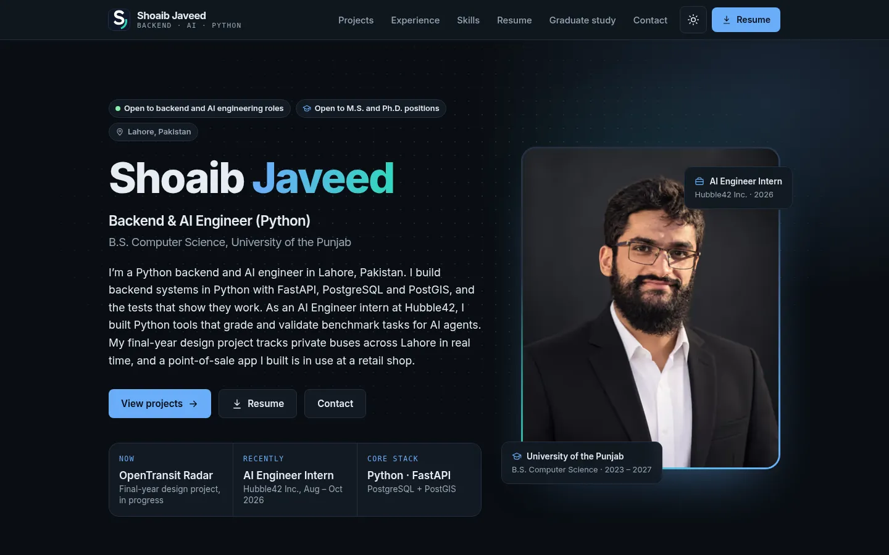
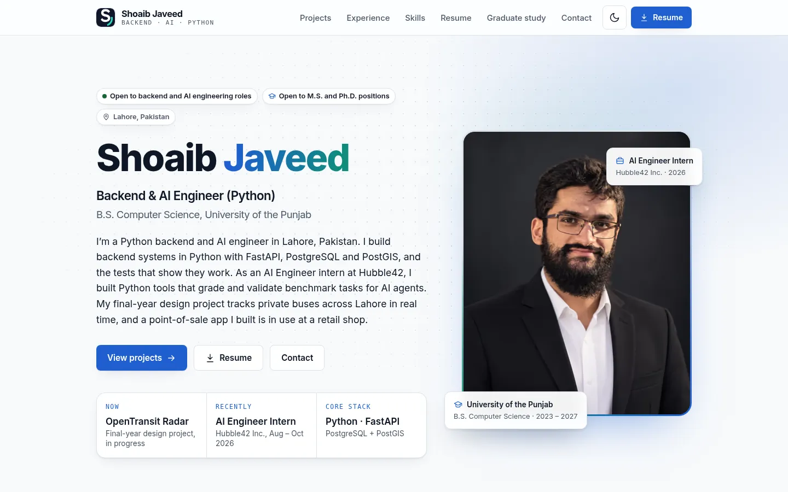
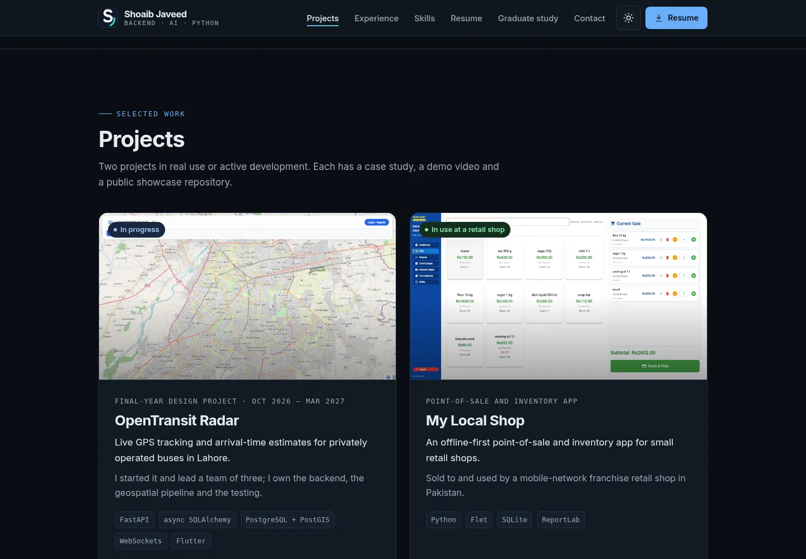
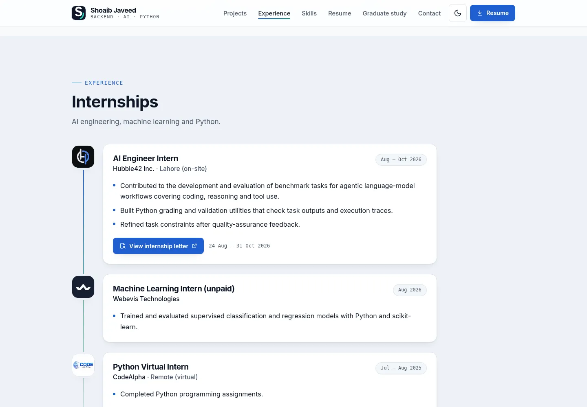
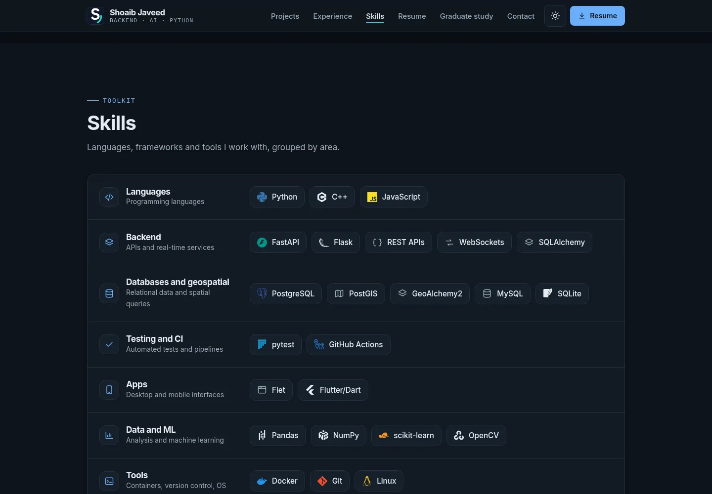
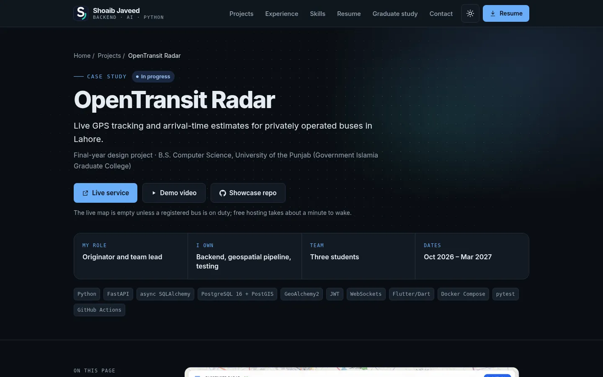
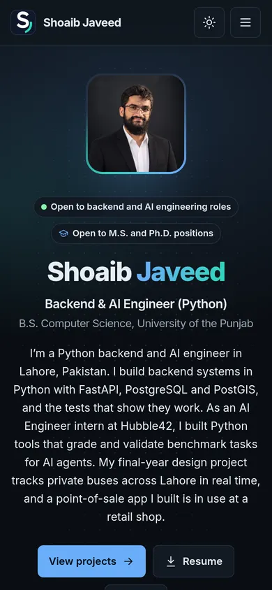
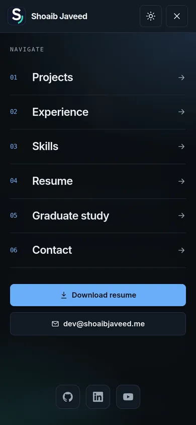

# shoaibjaveed.me: portfolio of Shoaib Javeed

**Live site: [shoaibjaveed.me](https://shoaibjaveed.me)** · Resume: [PDF](https://shoaibjaveed.me/resume/Shoaib_Javeed_Resume.pdf) · Projects: [OpenTransit Radar](https://shoaibjaveed.me/projects/opentransit-radar/) · [My Local Shop](https://shoaibjaveed.me/projects/my-local-shop/)

Personal portfolio of **Shoaib Javeed** (also written Shoaib Javed), Backend & AI Engineer (Python) in Lahore, Pakistan · B.S. Computer Science, University of the Punjab (2023 – 2027).

> This is a public showcase. The site's source code is kept in a private repository; this repository holds screenshots and a description of how the site is built. I am happy to walk through the code on request: [dev@shoaibjaveed.me](mailto:dev@shoaibjaveed.me).

## What the site contains

| Page | Content |
|---|---|
| [Home](https://shoaibjaveed.me/) | Introduction, projects, internships, education, skills, resume preview, graduate study, contact |
| [Projects](https://shoaibjaveed.me/projects/) | All projects, with case-study links |
| [OpenTransit Radar](https://shoaibjaveed.me/projects/opentransit-radar/) | Case study: live bus tracking for Lahore (FastAPI, PostgreSQL + PostGIS, WebSockets, Flutter) |
| [My Local Shop](https://shoaibjaveed.me/projects/my-local-shop/) | Case study: offline-first point-of-sale app (Python, Flet, SQLite) |
| [Resume](https://shoaibjaveed.me/resume/) | One-page, ATS-friendly resume (PDF) |
| [Graduate study](https://shoaibjaveed.me/graduate-study/) | Academic record and contact for master's and Ph.D. positions |

## How it is built

- **Next.js 14 (App Router), static export, Tailwind CSS.** Every page is plain HTML, so all text is readable without JavaScript.
- **One source of facts.** Every claim on the site, in the resume and in `llms.txt` comes from a single data file, so the site, resume and structured data never disagree.
- **Performance.** Responsive AVIF/WebP images with blur placeholders; self-hosted fonts; YouTube loads only on click; a service worker caches static files for repeat visits. No requests go to other sites on page load.
- **Accessibility.** WCAG 2.2 AA contrast in light and dark themes, keyboard navigation, visible focus, one `h1` per page, and every animation turned off under "reduce motion".
- **Motion without risk.** CSS-only animations and an IntersectionObserver scroll reveal; content is only hidden while that script runs, so it is never invisible.
- **Search and answer engines.** A unique title, description, canonical URL and 1200×630 share image per page; JSON-LD (`Person`, `ProfilePage`, `WebSite`, `BreadcrumbList`, `SoftwareSourceCode`, `VideoObject`, `DigitalDocument`, `CollectionPage`); an image sitemap; and [`llms.txt`](https://shoaibjaveed.me/llms.txt).
- **Resume.** Generated from an HTML source with headless Chrome, with a LaTeX twin; one page, one column, and visible, clickable URLs.
- **Deployment.** GitHub Actions builds the static site and publishes it to GitHub Pages behind Cloudflare.

## Lighthouse (local production build)

| Page | Mobile performance | Accessibility | Best practices | SEO |
|---|---|---|---|---|
| Home | 96–98 | 100 | 100 | 100 |
| Case studies | 96–98 | 100 | 100 | 100 |
| Resume | 97–98 | 100 | 100 | 100 |

Desktop scores 100 in all four categories on every page.

## Screenshots

| | |
|---|---|
|  |  |
|  |  |
|  | |

  
  

## Contact

**Shoaib Javeed** · [shoaibjaveed.me](https://shoaibjaveed.me) · [dev@shoaibjaveed.me](mailto:dev@shoaibjaveed.me) · [GitHub](https://github.com/shoaib-javeed-05) · [LinkedIn](https://www.linkedin.com/in/shoaib-javeed05) · [YouTube](https://www.youtube.com/@Shoaib-Javeed-05)

© 2026 Shoaib Javeed. Screenshots and text in this repository may not be reused without permission.
